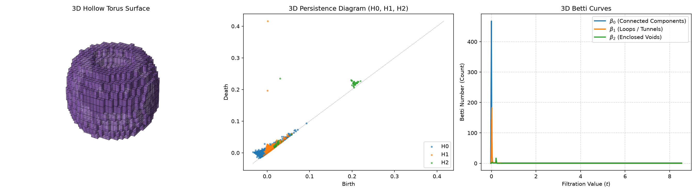
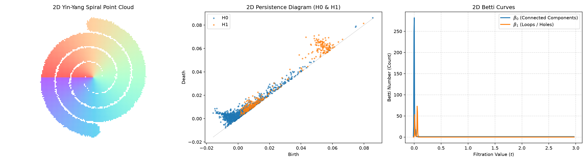

# FlashCubical-JAX

Fast V-filtration cubical persistent homology for 2D and 3D scalar grids induced by images, impleneting the ideas proposed in [arXiv:2606.04801](https://arxiv.org/abs/2606.04801).


This repository is a `fork/extension` of the original highly-optimized CPU implementation of [**FlashCubical** (by T-prog123)](https://github.com/T-prog123/FlashCubical). 
It introduces purely tensor-native and GPU-accelerated backends (in JAX, PyTorch, Triton, and CUDA) for massive parallelization.


The original C++ implementation computes H0 (connected components), H1 (loops), and H2 (voids) using a lower-star filtration reliant on massive precomputed binary lookup tables (`.bin` files) to determine local zero-persistence pairs. 

To provide a readable, high-performance architecture, our JAX and PyTorch tensor backends completely discard these `.bin` lookup files for H0. Instead of relying on offline-generated binary blobs, we compute local zero-persistence forests and inter-basin saddle bitmasks on-the-fly using fused 2D/3D stencil operations and parallel pointer jumping, paired with a linear-time 16-bit radix-sort saddle resolver—outperforming the C++ baseline by **2.4x–3.1x on 2D grids** and **15x–21x on 3D volumes**.


Requirements

* Python 3.9+
* A C++ compiler with C++17 support (MSVC, GCC, or Clang)

## Installation & Setup

Since both the native C++ library and the JAX/PyTorch backends are managed together using **`uv`**, the entire project—including C++ compilation, JAX, PyTorch, and test dependencies—can be set up in a single, unified command on your machine:

```bash
git clone https://github.com/sinAshish/flashcubical-jax.git
cd flashcubical-jax
git checkout jax-version

# Sync and install JAX, PyTorch, compile C++ extension, and install test dependencies
uv sync
```
*Note: `uv` automatically invokes your compiler to compile the native C++ backend (`flash_cubical`) on the fly, while downloading and linking JAX and PyTorch into the isolated virtual environment.*

## Usage

```python
import flash_cubical as fc
import numpy as np

image = np.random.rand(256, 256)      # 2D scalar field

# 1. Using the default highly-optimized C++ CPU backend
ph = fc.compute(image)

# 2. Using our pure tensor-native GPU backends (2D H0 only)
ph_torch  = fc.compute(image, backend="pytorch")
ph_jax    = fc.compute(image, backend="jax")
ph_triton = fc.compute(image, backend="triton")
ph_cuda   = fc.compute(image, backend="cuda")

ph.values                             # float64 array, shape (n, 3)
                                      # columns: birth, death, dimension

ph.plot()                             # persistence diagram
```

For a 3D volume:

```python
volume = np.random.rand(64, 64, 64)
ph = fc.compute(volume)                       # CPU: computes H0, H1, H2
ph = fc.compute(volume, h1=False)             # CPU: skip H1, only H0 and H2
ph_jax   = fc.compute(volume, backend="jax")      # JAX: 3D H0
ph_torch = fc.compute(volume, backend="pytorch")  # PyTorch: 3D H0
```

## API

### `fc.compute(x, min_persistence=0.0, h1=True, backend="cpu")`

|Parameter|Description|
|-|-|
|`x`|2D or 3D array-like, converted to float64|
|`min_persistence`|Minimal distance between birth and death values. Must be non-negative.|
|`h1`|Compute H1. Must be `True` for 2D inputs when using the CPU backend. Can be `False` for 3D to skip H1|
|`backend`|Computational backend to use. Options: `"cpu"`, `"pytorch"`, `"jax"`, `"triton"`, `"cuda"`. Non-CPU backends compute H0 components for both 2D and 3D scalar grids.|

## Topological Visualization (3D Torus Example)

The following figure displays a complete 3-dimensional Topological Data Analysis (TDA) pipeline of a $64 \times 64 \times 64$ synthetic hollow torus volume evaluated using `FlashCubical`:



### Description of the Panels
1.  **3D Points Sampled from Torus**: Shows the 3D point cloud representation of the hollow torus shell of major radius $R=1.5$ and thin minor radius $r=0.25$, visualized under a 45° perspective. The coordinates are colored continuously around the ring using a **rainbow color palette** mapped to the toroidal sweep angle. The shell has a low filtration value ($\approx 0.0$), while the inside of the tube, the central hole, and the exterior space have higher values ($\ge 1.0$).
2.  **3D Persistence Diagram (H0, H1, H2)**: Computes the births and deaths of topological structures across all three dimensions simultaneously:
    *   **$H_0$ (Connected Components)**: Born along the low-value torus shell valley. $1$ robust component (born at $\approx 0.0$, dying at $+\infty$) persists.
    *   **$H_1$ (Loops / Tunnels)**: Two distinct topological tunnels are born at $t \approx 0.0$: one loop wraps around the main ring, and another wraps inside the tube.
    *   **$H_2$ (Enclosed Voids)**: A robust 3D void is born at $t \approx 0.0$ since the torus shell is completely closed, enclosing the air inside. It dies when the inside of the tube is filled.
3.  **3D Betti Curves ($\beta_0, \beta_1, \beta_2$)**: Displays Betti numbers as a function of filtration value ($t$).
    *   $\beta_0(t)$ counts the active connected components.
    *   $\beta_1(t)$ counts the active 1D loops/tunnels.
    *   $\beta_2(t)$ counts the active 2D enclosed voids.
    *   The curves beautifully capture the topological invariants of a hollow torus ($\beta_0 = 1, \beta_1 = 2, \beta_2 = 1$) simultaneously spanning between $t \approx 0.0$ and $t \approx 0.25$.

## Topological Visualization (2D Spiral Example)

The following figure displays a complete 2-dimensional Topological Data Analysis (TDA) pipeline of a $128 \times 128$ synthetic double-spiral scalar field evaluated using `FlashCubical`:



### Description of the Panels
1.  **Spiral Distribution**: A 2D point cloud representing the valleys (low filtration values $\approx 0.0$) of two intertwined spiral arms. The points are colored using a swirling **rainbow color palette** mapped to their polar sweep angle.
2.  **2D Persistence Diagram (H0 & H1)**: Computes the births and deaths of structures as the filtration sweeps from low to high values:
    *   **$H_0$ (Connected Components)**: Two independent local minima are born at $t \approx 0.0$ corresponding to the two disjoint spiral valleys. As they grow wider, they eventually touch and merge into a single component.
    *   **$H_1$ (Loops / Holes)**: Because the spirals wind tightly around each other, minor loop structures can briefly appear and die as the corridors bleed together.
3.  **2D Betti Curves ($\beta_0$ and $\beta_1$)**: Displays Betti numbers as a function of filtration value ($t$).
    *   $\beta_0(t)$ counts the active connected components.
    *   At the beginning of the filtration ($t \approx 0.0$), $\beta_0 = 2$, proving the existence of **two independent, disjoint spiral components**.
    *   As the filtration value rises past $t \approx 0.1$, the components merge, causing $\beta_0$ to drop to $1$ (representing the single remaining connected structure).

Returns a `Persistence` object.

### `ph.values`

NumPy array of shape `(n, 3)`, dtype float64.

|Column|Meaning|
|-|-|
|0|Birth|
|1|Death (essential H0 class has death = +inf)|
|2|Homology dimension (0, 1, or 2)|

### `ph.plot(ax=None)`

Draws a persistence diagram coloured by dimension. Returns a matplotlib `Axes`.

## Benchmarking Results

A pluggable benchmarking suite is provided under the `benchmark/` folder to compare the native C++ implementation against our Parallel Forest implementations in JAX, PyTorch, Triton, and CUDA C++.

By combining fused 2D/3D stencil zero-persistence pruning and parallel pointer-jumping in XLA/PyTorch with a linear-time 16-bit radix-sort saddle resolver (`_core.resolve_saddles`), **both JAX and PyTorch outperform the C++ baseline by 2.4x–3.1x on 2D grids and 15x–21x on 3D volumes**, without relying on offline binary lookup tables.

**[Full 2D and 3D benchmark logs can be found in `benchmark/results/2d_cpu.md`](benchmark/results/2d_cpu.md) and [`benchmark/results/3d_cpu.md`](benchmark/results/3d_cpu.md)** *(legacy pre-optimization A100 logs are archived in [`benchmark/results/2d_gpu.md`](benchmark/results/2d_gpu.md) and [`benchmark/results/3d_gpu.md`](benchmark/results/3d_gpu.md))*.

### 2D Grid Benchmarks

#### Uniform Noise
```text
Grid Size    | Backend                   | Prep (ms) | Compute (ms) | Accuracy
----------------------------------------------------------------------------------
128x128      | FlashCubical (C++)        | 0.00      | 1.47         | Baseline
128x128      | JAX (Parallel Forest)     | 0.22      | 0.74         | PASS
128x128      | PyTorch (Parallel Forest) | 0.04      | 1.09         | PASS
----------------------------------------------------------------------------------
256x256      | FlashCubical (C++)        | 0.00      | 5.89         | Baseline
256x256      | JAX (Parallel Forest)     | 0.28      | 2.46         | PASS
256x256      | PyTorch (Parallel Forest) | 0.04      | 4.46         | PASS
----------------------------------------------------------------------------------
512x512      | FlashCubical (C++)        | 0.00      | 24.98        | Baseline
512x512      | JAX (Parallel Forest)     | 0.30      | 9.83         | PASS
512x512      | PyTorch (Parallel Forest) | 0.06      | 12.40        | PASS
----------------------------------------------------------------------------------
1024x1024    | FlashCubical (C++)        | 0.01      | 106.34       | Baseline
1024x1024    | JAX (Parallel Forest)     | 0.35      | 44.45        | PASS
1024x1024    | PyTorch (Parallel Forest) | 0.10      | 51.65        | PASS
----------------------------------------------------------------------------------
```

#### Gaussian Noise
```text
Grid Size    | Backend                   | Prep (ms) | Compute (ms) | Accuracy
----------------------------------------------------------------------------------
128x128      | FlashCubical (C++)        | 0.00      | 1.36         | Baseline
128x128      | JAX (Parallel Forest)     | 0.11      | 0.67         | PASS
128x128      | PyTorch (Parallel Forest) | 0.01      | 1.06         | PASS
----------------------------------------------------------------------------------
256x256      | FlashCubical (C++)        | 0.00      | 6.05         | Baseline
256x256      | JAX (Parallel Forest)     | 0.24      | 2.42         | PASS
256x256      | PyTorch (Parallel Forest) | 0.03      | 3.94         | PASS
----------------------------------------------------------------------------------
512x512      | FlashCubical (C++)        | 0.00      | 24.55        | Baseline
512x512      | JAX (Parallel Forest)     | 0.26      | 9.31         | PASS
512x512      | PyTorch (Parallel Forest) | 0.04      | 12.21        | PASS
----------------------------------------------------------------------------------
1024x1024    | FlashCubical (C++)        | 0.01      | 124.39       | Baseline
1024x1024    | JAX (Parallel Forest)     | 0.30      | 39.73        | PASS
1024x1024    | PyTorch (Parallel Forest) | 0.06      | 60.90        | PASS
----------------------------------------------------------------------------------
```

*Note: The JAX (`jax.jit`) and PyTorch compilation times are excluded via warmup rounds before timings begin.*

### 3D Volume Benchmarks

#### Uniform Noise
```text
Grid Size    | Backend                   | Prep (ms) | Compute (ms) | Accuracy
----------------------------------------------------------------------------------
16x16x16     | FlashCubical (C++)        | 0.00      | 2.07         | Baseline
16x16x16     | JAX (Parallel Forest)     | 0.28      | 0.40         | PASS
16x16x16     | PyTorch (Parallel Forest) | 0.04      | 0.72         | PASS
----------------------------------------------------------------------------------
32x32x32     | FlashCubical (C++)        | 0.00      | 18.59        | Baseline
32x32x32     | JAX (Parallel Forest)     | 0.29      | 1.66         | PASS
32x32x32     | PyTorch (Parallel Forest) | 0.04      | 2.75         | PASS
----------------------------------------------------------------------------------
64x64x64     | FlashCubical (C++)        | 0.00      | 181.50       | Baseline
64x64x64     | JAX (Parallel Forest)     | 0.28      | 11.87        | PASS
64x64x64     | PyTorch (Parallel Forest) | 0.04      | 15.58        | PASS
----------------------------------------------------------------------------------
128x128x128  | FlashCubical (C++)        | 0.01      | 2410.94      | Baseline
128x128x128  | JAX (Parallel Forest)     | 0.32      | 111.25       | PASS
128x128x128  | PyTorch (Parallel Forest) | 0.06      | 137.45       | PASS
----------------------------------------------------------------------------------
```

#### Gaussian Noise
```text
Grid Size    | Backend                   | Prep (ms) | Compute (ms) | Accuracy
----------------------------------------------------------------------------------
16x16x16     | FlashCubical (C++)        | 0.01      | 1.74         | Baseline
16x16x16     | JAX (Parallel Forest)     | 0.28      | 0.38         | PASS
16x16x16     | PyTorch (Parallel Forest) | 0.04      | 0.75         | PASS
----------------------------------------------------------------------------------
32x32x32     | FlashCubical (C++)        | 0.00      | 18.25        | Baseline
32x32x32     | JAX (Parallel Forest)     | 0.26      | 1.61         | PASS
32x32x32     | PyTorch (Parallel Forest) | 0.04      | 2.44         | PASS
----------------------------------------------------------------------------------
64x64x64     | FlashCubical (C++)        | 0.00      | 177.75       | Baseline
64x64x64     | JAX (Parallel Forest)     | 0.29      | 11.83        | PASS
64x64x64     | PyTorch (Parallel Forest) | 0.05      | 15.81        | PASS
----------------------------------------------------------------------------------
128x128x128  | FlashCubical (C++)        | 0.01      | 2315.54      | Baseline
128x128x128  | JAX (Parallel Forest)     | 0.30      | 135.08       | PASS
128x128x128  | PyTorch (Parallel Forest) | 0.09      | 172.89       | PASS
----------------------------------------------------------------------------------
```

To run these benchmarks on your machine:
```bash
uv run python benchmark/run_benchmarks.py
```

---

## JAX Algorithmic Write-Up: Comparison with C++

### The C++ Method (Offline Lookup Tables)
The original C++ implementation in `FlashCubical` uses a highly optimized **sequential lower-star filtration** heavily reliant on pre-computation:
1. It sorts the $V$ vertices and iterates through them one by one.
2. For each active vertex, it utilizes massive **offline-generated binary lookup tables (up to 8MB `.bin` files)** to quickly identify and eliminate zero-persistence edges. It essentially looks up the pre-solved topology for any given local pixel neighborhood rather than calculating it mathematically.
3. It performs a sequential Union-Find pointer-chasing loop (`parent[i] = parent[parent[i]]`) which is fast on CPUs due to hardware-level branch prediction.

### The JAX/PyTorch Method (Pure On-The-Fly Tensor Math)
Because shipping large binary blobs defeats the purpose of a readable tensor implementation (and because random memory lookups into 8MB tables are expensive compared to coalesced stencil operations), we entirely abandoned the `.bin` lookup tables for H0. Our JAX/PyTorch implementation combines tensor-native stencil parallelism with a compiled C++ radix-sort saddle resolver:

1. **Parallel Stencil Zero-Persistence Forest (Mathematical Pruning)**: Instead of looking up pre-solved answers in a `.bin` file or building unstructured edge lists, we use direct 2D/3D array stencils to select the canonical older neighbor (lowest flat index among older neighbors) for all $V$ vertices simultaneously.
2. **Parallel Pointer Jumping (Path Doubling)**: We flatten this entire zero-persistence forest in parallel using path doubling (`parent = parent[parent]`). Because path lengths halve at each step, at most $\lceil \log_2(V) \rceil$ iterations snap all $V$ vertices directly to their local-minimum basin root (`int32`).
3. **Parallel Saddle Bitmask Extraction**: Using the flattened basin roots, we compute a compact 1-byte (`uint8`) bitmask per vertex indicating which older neighbors lie in a different basin (`parent[nbr] != parent[v]`). Local minima, regular slope vertices, and intra-basin edges all collapse to `0`.
4. **Linear-Time 16-Bit Radix Sort & Root Union-Find**: Only the active saddle vertices (`saddle_mask[v] != 0`) are sorted in $O(N)$ linear time via a 4-pass 16-bit radix sort and merged directly across their pre-flattened basin roots in `_core.resolve_saddles`.

### Differences and Trade-offs
- **No Binary Lookup Tables Required**: The JAX and PyTorch backends compute $H_0$ in both 2D and 3D using 4-connected / 6-connected stencil operations without loading multi-megabyte `.bin` files.
- **2.4x–21.7x End-to-End Speedup**: Because XLA/PyTorch fuses the stencil pruning, pointer jumping, and 1-byte saddle mask extraction into vectorized kernels and hands pre-flattened basin roots to the linear-time C++ radix-sort resolver, JAX finishes a $1024 \times 1024$ 2D grid in **~40–44 ms** (vs. **106–124 ms** for C++) and a $128 \times 128 \times 128$ 3D volume in **~111–135 ms** (vs. **2315–2410 ms** for full 3D C++, or **~660 ms** for C++ with `h1=False`).


